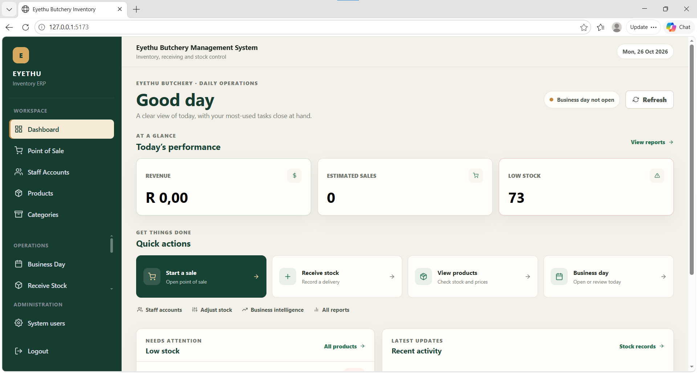
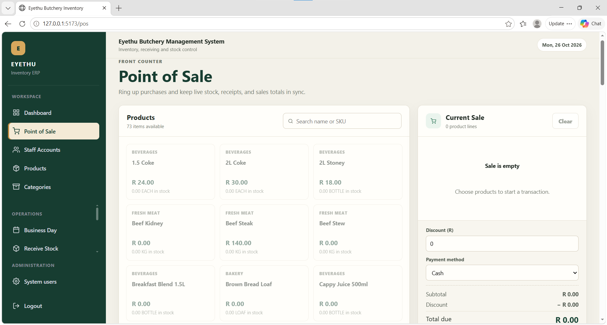
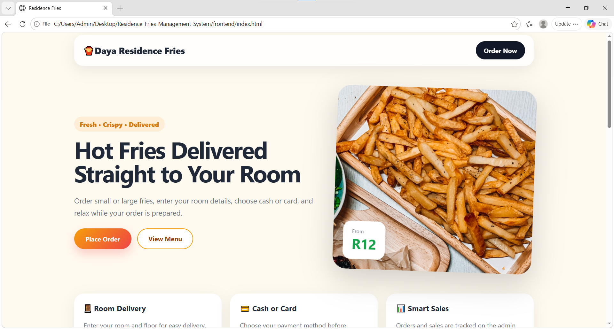
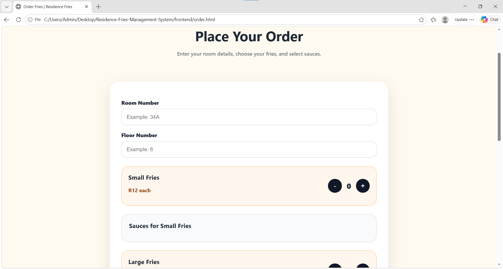
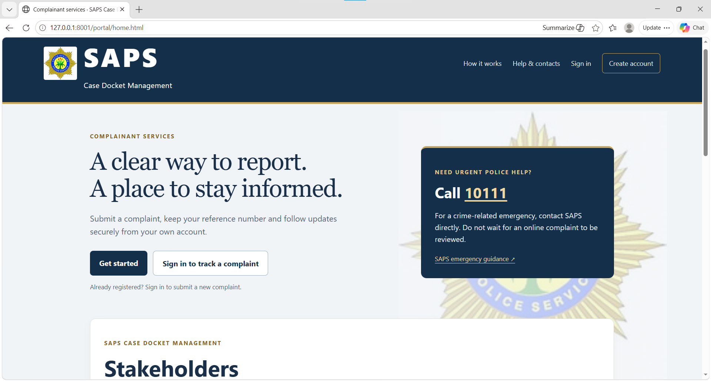
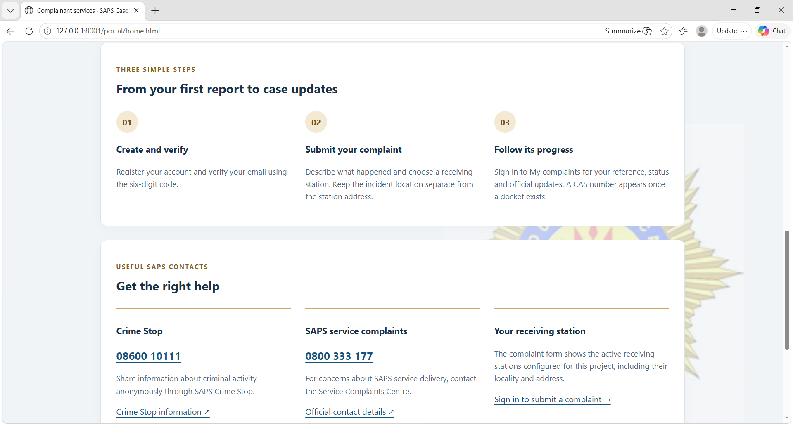

<h1 align="center">Hi, I'm Mila Twantwa 👋</h1>

<h2 align="center">🎓 Final-year ICT Student · Durban University of Technology</h2>

  ⚙️ <strong>Data Engineering</strong> • Python • SQL • Pandas • ETL Pipelines • Java 
  I turn raw data into reliable systems, and build the applications that produce it.

  
  

  
  
  

 

I'm a final-year ICT student who enjoys building efficient systems end to end. My ETL projects pull data from APIs and databases, clean it with Pandas and load it somewhere it can be trusted. My applications are full products with real workflows. Currently focused on **data pipelines**, **data quality** and **AI-assisted tooling**.

 

## 🛠 Tech Stack

  
  
  
  
  
  
  
  
  
  
  
  
  
  

 

## 🗃️ Featured Projects

| 📌 Project | 🧠 Description | 🛠 Tools |
|---|---|---|
| 🥩 [Eyethu Butchery Management System](https://github.com/Mila522?tab=repositories) | Inventory and point-of-sale system with live stock, deliveries, business-day control and a sales dashboard. | Full-stack web app |
| 🍟 [Residence Fries Management System](https://github.com/Mila522/Residence-Fries-Management-System) | Room-delivery ordering with cash or card payment, order tracking and sales analytics. | Java, JavaScript |
| 🛡️ [SAPS Case Docket Management](https://github.com/Mila522?tab=repositories) | Complainant portal: register, verify email, submit a complaint and track its progress. | Full-stack web app |
| 🌦️ [Weather ETL Pipeline](https://github.com/Mila522/weather-etl-pipeline) | Live Open-Meteo data cleaned with Pandas and loaded into SQL Server, with logging on every run. | Python, Pandas, SQL Server |
| 🎓 [Alumni Nexus](https://github.com/Mila522/Alumni-Nexus) | Team-built alumni mentorship platform. I designed the database and the engagement analytics dashboard. | Python, Flask, SQLite |
| 🌾 [AgriGuard AI](https://github.com/Mila522/Smart-Agriculture-assistant) | Smart agriculture assistant with weather, AI crop disease detection and market prices. | Java |
| 🧹 [CSV Cleaning Pipeline](https://github.com/Mila522/RAW-CSV-DATA-CLEANED-INTO-STRUCTURED-CSV) | Fixes missing values, duplicates and invalid formats in raw CSV data. | Python, Pandas |
| 🔁 [SQL Database ETL](https://github.com/Mila522/extracting-data-from-databaseSource-to-a-targetDatabase) | Extract from a source database, transform and load into a target database. | Python, SQL, Pandas |

 

<h2 align="center">🥩 Inventory &amp; Point of Sale 🥩</h2>

  <strong>Eyethu Butchery Management System</strong> 
  Live stock, receiving, business-day control and a front-counter POS with discounts and payment methods.

  
  
  
  

<strong>PREVIEW</strong>

  
  

<h2 align="center">🍟 Ordering &amp; Sales 🍟</h2>

  <strong>Residence Fries Management System</strong> 
  Students order to their room, and the admin side tracks orders, payments and sales.

  
  
  
  

<strong>PREVIEW</strong>

  
  

<h2 align="center">🛡️ Case Management 🛡️</h2>

  <strong>SAPS Case Docket Management (complainant portal)</strong> 
  Register, verify by email, submit a complaint to a station and follow its status. <em>Student project, not affiliated with SAPS.</em>

  
  
  

<strong>PREVIEW</strong>

  
  

<h2 align="center">⚙️ Data Pipelines ⚙️</h2>

  <strong>Weather ETL · SQL Database ETL · CSV Cleaning</strong> 
  Extract from APIs, databases and files • Transform and validate with Pandas • Load into SQL targets • Logging and data quality

  
  
  
  

 

## 📊 GitHub Stats

  

 

 

---

## ⌛ 2026 DATA CAREER ROADMAP

<i>From pipelines and applications to production-grade data systems.</i>

<table>
  <tr>
    <td width="33%" valign="top">
      <h3 align="center">🟢 FOUNDATION</h3>
      

      <ul>
        <li>Python and SQL fundamentals</li>
        <li>ETL pipelines with Pandas</li>
        <li>Full applications (Flask, Java)</li>
        <li>Google AI Essentials</li>
        <li>Cisco: Data Science and IoT</li>
      </ul>
      

        
      

    </td>
    <td width="34%" valign="top">
      <h3 align="center">🔵 GROWTH</h3>
      

      <ul>
        <li>Final-year ICT studies</li>
        <li>End-to-end data projects</li>
        <li>Data quality tooling with AI</li>
        <li>Analytics dashboards</li>
      </ul>
      

        
      

    </td>
    <td width="33%" valign="top">
      <h3 align="center">🟣 NEXT LEVEL</h3>
      

      <ul>
        <li>Cloud fundamentals</li>
        <li>Orchestration and data warehousing</li>
        <li>Professional portfolio expansion</li>
        <li>Junior Data Engineer role</li>
      </ul>
      

    </td>
  </tr>
</table>

  
  &nbsp;➜&nbsp;
  
  &nbsp;➜&nbsp;
  
  &nbsp;➜&nbsp;
  

---

<h2 align="center">📍 Current Focus</h2>

  

## 🎯 Career Goal

To become a data engineer who builds dependable pipelines and the systems around them, turning raw data into trusted, usable information.

  
  
  
  

 

## 📫 Connect With Me

  
  
  

<em>Building today, engineering tomorrow.</em>

